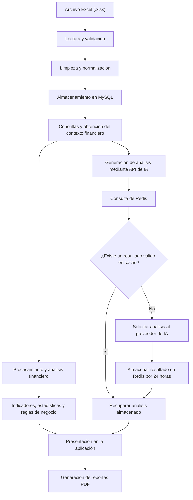

<div align="center">

# Finanzen — Sistema de Análisis Financiero

**Transforma los registros de tu negocio en información útil para tomar mejores decisiones.**

Finanzen es una aplicación de escritorio desarrollada en Python para micro y pequeños negocios. Permite importar información desde archivos Excel, consultar ventas, ingresos y gastos, analizar su comportamiento financiero y obtener recomendaciones mediante reglas de negocio y una API de inteligencia artificial.

Su objetivo es facilitar la interpretación de los datos del negocio mediante indicadores, gráficos, comparaciones entre períodos, análisis asistidos por IA y reportes financieros en PDF.


</div>

---

## Descripción

Los micro y pequeños negocios suelen almacenar sus registros financieros en hojas de cálculo. Aunque estos archivos permiten conservar la información, no siempre ofrecen herramientas suficientes para comprender su evolución, detectar variaciones importantes o utilizar los datos como apoyo para tomar decisiones.

**Finanzen** busca atender esta necesidad mediante una aplicación que procesa los registros del negocio y los transforma en información organizada y comprensible. Para ello integra análisis estadístico, indicadores financieros, reglas de negocio e inteligencia artificial.

La aplicación permite centralizar la información importada, consultar los movimientos registrados, comparar resultados entre períodos, identificar comportamientos relevantes y generar informes.

Finanzen está orientado al análisis financiero operativo y al apoyo en la toma de decisiones. No pretende sustituir un sistema contable, un ERP ni los servicios de un profesional de contabilidad.

## Problema que aborda

Entre las dificultades que busca reducir se encuentran:

- Dificultad para interpretar la evolución de las ventas.
- Falta de claridad sobre el comportamiento de los ingresos y gastos.
- Complicaciones para comparar resultados entre diferentes períodos.
- Dificultad para identificar categorías con variaciones relevantes.
- Errores e inconsistencias en los registros importados.
- Falta de herramientas accesibles para generar informes financieros.
- Toma de decisiones basada principalmente en la intuición y no en datos organizados.

## Objetivo general

Desarrollar una aplicación de escritorio que permita importar, almacenar, analizar y visualizar información financiera de micro y pequeños negocios, generando indicadores, comparaciones, recomendaciones y reportes que faciliten la interpretación de sus resultados y apoyen la toma de decisiones.

## Funcionalidades principales

### 1. Importación y validación de archivos Excel

Permite importar información financiera desde archivos `.xlsx`, validando su estructura y los datos contenidos en las hojas correspondientes.

Entre sus funcionalidades se encuentran:

- Validación de columnas y registros.
- Comprobación de tipos y valores.
- Limpieza, normalización y preparación de los datos.
- Identificación de errores y advertencias.
- Detección de archivos duplicados.
- Identificación de categorías que necesitan crearse o corregirse.
- Almacenamiento de la información validada en MySQL.

El proceso de importación se ejecuta en segundo plano para evitar que las operaciones de lectura, validación y almacenamiento bloqueen la interfaz gráfica.

### 2. Gestión de usuarios y negocios

Permite administrar el acceso a la aplicación y organizar la información según los negocios registrados.

Incluye:

- Registro e inicio de sesión.
- Administración de usuarios.
- Gestión de negocios.
- Asignación de roles y permisos.
- Asociación de usuarios con sus negocios.

Los permisos determinan las operaciones disponibles para cada usuario dentro de la aplicación.

### 3. Panel principal

Presenta un resumen de la actividad financiera del negocio mediante indicadores, gráficos y tablas.

Permite consultar información relevante, como:

- Total de ventas de un período.
- Ingresos y gastos registrados.
- Evolución de las ventas.
- Transacciones recientes.
- Resumen de la actividad del negocio.

### 4. Análisis financiero

Procesa los registros almacenados para ofrecer una visión más detallada del comportamiento financiero del negocio.

Incluye:

- Análisis de ingresos y gastos.
- Comparaciones entre períodos.
- Análisis de variaciones porcentuales.
- Estadísticas descriptivas.
- Análisis por categorías.
- Evaluación de la variabilidad de las ventas.
- Indicadores como el ticket promedio.
- Visualización de tendencias y distribución de los datos.

Los períodos de análisis se seleccionan mediante los filtros disponibles en la interfaz.

### 5. Recomendaciones basadas en reglas de negocio

Genera observaciones y sugerencias a partir de reglas definidas y resultados estadísticos.

Estas recomendaciones pueden ayudar a identificar:

- Incrementos relevantes en los gastos.
- Variaciones importantes en las ventas.
- Cambios en los ingresos.
- Comportamientos que merecen una revisión.
- Oportunidades de mejora a partir de los registros disponibles.

Las recomendaciones se basan en condiciones y cálculos verificables. No constituyen predicciones infalibles ni sustituyen el criterio del responsable del negocio.

### 6. Análisis financiero mediante inteligencia artificial

Finanzen integra una API de inteligencia artificial para generar interpretaciones y recomendaciones en lenguaje natural a partir del contexto financiero del negocio.

El sistema contempla cuatro modalidades de análisis:

- **General:** ofrece una interpretación global de la información financiera disponible.
- **Ventas:** analiza el comportamiento y las variaciones de las ventas.
- **Ingresos:** interpreta los ingresos registrados como movimientos financieros.
- **Gastos:** examina el comportamiento de los gastos y sus variaciones.

Para generar estos resultados, la aplicación obtiene información relevante de la base de datos, construye un contexto financiero y lo utiliza para preparar la solicitud enviada al proveedor de IA.

La integración contempla:

- Construcción de contexto financiero a partir de los registros del negocio.
- Preparación de instrucciones para orientar las respuestas del modelo.
- Separación entre la lógica de obtención de datos, la construcción del contexto y la comunicación con el proveedor de IA.
- Ejecución de las solicitudes en segundo plano para mantener la interfaz receptiva.
- Presentación de los resultados en la sección de recomendaciones.

Las respuestas se generan a partir de los datos disponibles y de las instrucciones proporcionadas al modelo. Por ello, deben utilizarse como apoyo para interpretar la información, no como sustituto de una evaluación profesional.

### 7. Caché de análisis con Redis

Finanzen utiliza Redis como sistema de almacenamiento temporal para reducir la repetición de cálculos y solicitudes de análisis predefinidos.

Los resultados de los análisis de IA correspondientes a las modalidades General, Ventas, Ingresos y Gastos se almacenan temporalmente en caché.

Características principales:

- **Tiempo de expiración:** los resultados almacenados tienen una duración de 24 horas.
- **Separación por negocio:** la información de caché se organiza considerando el negocio al que corresponde el análisis.
- **Reutilización de resultados:** cuando existe un análisis válido en caché, puede recuperarse sin volver a solicitar su generación al proveedor de IA.
- **Invalidación de caché:** los resultados se invalidan cuando se realizan operaciones que modifican la información financiera utilizada para generarlos, como importar o eliminar datos financieros.
- **Datos actualizados:** después de una invalidación, el siguiente análisis debe generarse utilizando la información financiera vigente.

Redis se utiliza exclusivamente como mecanismo de caché para los análisis predefinidos. No sustituye a MySQL como almacenamiento persistente y no se utiliza para almacenar las conversaciones o consultas libres del asistente.

### 8. Generación de reportes PDF

Permite generar informes financieros a partir de la información procesada por la aplicación.

La generación de documentos utiliza plantillas HTML y CSS para estructurar la presentación de los resultados y convertirlos en archivos PDF.

Las tecnologías empleadas son:

- **Jinja2:** construcción de documentos HTML mediante plantillas dinámicas.
- **WeasyPrint:** conversión de documentos HTML y CSS a PDF.

Este enfoque permite organizar los informes en secciones y presentar indicadores, tablas, gráficos y resultados de manera estructurada.

## Flujo general del sistema

El siguiente esquema representa el flujo principal desde la importación de información hasta la generación de análisis y reportes:



**Nota:** Redis interviene en la recuperación y reutilización de los análisis predefinidos. Las consultas libres del asistente de IA siguen su flujo de solicitud correspondiente y no utilizan esta caché.

## Tecnologías utilizadas

| Tecnología | Propósito |
|---|---|
| Python | Lenguaje principal de desarrollo. |
| PySide6 | Desarrollo de la interfaz gráfica de escritorio. |
| SQLAlchemy | Mapeo objeto-relacional y acceso a la base de datos. |
| MySQL | Almacenamiento persistente de la información del sistema. |
| Redis | Almacenamiento temporal y recuperación de análisis mediante caché. |
| API de inteligencia artificial | Generación de interpretaciones y recomendaciones financieras en lenguaje natural. |
| Pandas | Lectura, transformación y procesamiento tabular de datos, principalmente durante la importación de Excel. |
| OpenPyXL | Lectura y procesamiento de archivos Excel. |
| Matplotlib | Generación de gráficos financieros. |
| Jinja2 | Renderizado de plantillas HTML para los reportes. |
| WeasyPrint | Generación de archivos PDF desde HTML y CSS. |
| Git y GitHub | Control de versiones y colaboración en el desarrollo. |

## Arquitectura del proyecto

Finanzen organiza sus componentes en módulos y capas para separar responsabilidades, facilitar el mantenimiento y reducir el acoplamiento entre la interfaz, la lógica de negocio y los mecanismos de persistencia.

La arquitectura contempla las siguientes responsabilidades:

- **Interfaz de usuario:** interacción con el usuario y presentación de los resultados mediante PySide6.
- **Controladores:** coordinación de las acciones solicitadas desde la interfaz y orquestación de los procesos correspondientes.
- **Servicios:** implementación de los casos de uso, coordinación de operaciones y gestión de la lógica de negocio.
- **Repositorios:** consultas y operaciones de persistencia mediante SQLAlchemy.
- **Modelos:** representación de las entidades almacenadas en la base de datos.
- **Funciones de análisis:** cálculos estadísticos, comparaciones y generación de hallazgos.
- **Módulo de inteligencia artificial:** obtención del contexto financiero, construcción de instrucciones y comunicación con el proveedor de IA.
- **Trabajadores en segundo plano:** ejecución de operaciones que pueden tomar tiempo, como importaciones y solicitudes de análisis, sin bloquear la interfaz.
- **Servicio de caché:** comunicación con Redis, recuperación de resultados, almacenamiento temporal e invalidación de análisis.
- **Utilidades:** funciones auxiliares para fechas, formatos y otras operaciones comunes.
- **Plantillas de reportes:** estructura y presentación de los documentos PDF.

Esta separación permite mantener la lógica financiera independiente de la interfaz y facilita la evolución de los mecanismos de almacenamiento, caché e integración con servicios externos.

### Responsabilidades de almacenamiento

Finanzen utiliza dos mecanismos de almacenamiento con propósitos diferentes:

| Componente | Responsabilidad | Naturaleza |
|---|---|---|
| MySQL | Usuarios, negocios, categorías, importaciones y registros financieros. | Persistente |
| Redis | Resultados temporales de análisis predefinidos para su reutilización. | Caché con expiración |

MySQL conserva la información principal del sistema. Redis complementa este almacenamiento acelerando el acceso a resultados que pueden reutilizarse durante un período determinado.

## Usuarios objetivo

Finanzen está dirigido principalmente a micro y pequeños negocios, entre ellos:

- Pulperías y tiendas de barrio.
- Cafeterías y pequeños restaurantes.
- Tiendas de ropa.
- Ferreterías.
- Emprendimientos y negocios familiares.
- Pequeños comercios que administran sus registros mediante Excel.

La aplicación busca presentar la información de manera comprensible, incluso para usuarios sin conocimientos avanzados de estadística o contabilidad.

## Alcance del proyecto

El sistema se enfoca en el análisis de información financiera registrada y almacenada en la aplicación.

Dentro de su alcance se encuentran:

- Importación y validación de archivos Excel.
- Gestión de usuarios y negocios.
- Consulta de ventas, ingresos y gastos.
- Análisis estadístico y financiero.
- Visualización de indicadores y gráficos.
- Recomendaciones basadas en reglas de negocio.
- Análisis e interpretaciones mediante una API de inteligencia artificial.
- Almacenamiento temporal de resultados de análisis mediante Redis.
- Generación de reportes financieros en PDF.

### Fuera del alcance

Finanzen no pretende ofrecer, como parte de su alcance actual:

- Contabilidad empresarial completa.
- Facturación electrónica.
- Declaraciones fiscales.
- Gestión integral de inventarios.
- Administración de nóminas.
- Integraciones bancarias automáticas.
- Sustitución de un sistema ERP.
- Garantía de predicciones o resultados infalibles generados por inteligencia artificial.

## Instalación y ejecución

Los pasos exactos de instalación dependen de la configuración del proyecto y de los archivos de dependencias incluidos en el repositorio.

### Requisitos generales

Para ejecutar Finanzen se requiere:

- Python compatible con las dependencias del proyecto.
- Un servidor MySQL.
- Un servidor Redis accesible desde la aplicación.
- Las dependencias de Python del proyecto.
- Una clave de acceso válida para el proveedor de inteligencia artificial.
- Las variables de entorno necesarias para configurar las conexiones y servicios externos.

### Configuración

Antes de ejecutar la aplicación, es necesario configurar los servicios externos y las credenciales correspondientes.

1. Configurar la conexión a MySQL.
2. Configurar la conexión a Redis.
3. Configurar la clave y los parámetros del proveedor de inteligencia artificial.
4. Definir las demás variables de entorno requeridas por el proyecto.
5. Preparar el esquema de la base de datos mediante el mecanismo de migraciones utilizado por la aplicación.

Las credenciales y claves de acceso deben mantenerse en variables de entorno y no deben publicarse en el repositorio.

### Ejecución

Una vez preparado el entorno e instaladas las dependencias, ejecutar la aplicación desde la raíz del proyecto:

```bash
python -m app.main
```

Consulta los archivos de configuración y dependencias del repositorio para conocer los valores y comandos específicos de cada entorno.

## Consideraciones sobre inteligencia artificial y caché

- La disponibilidad de los análisis generados mediante IA depende de la conexión con el proveedor externo y de la validez de sus credenciales.
- Las respuestas de IA pueden contener interpretaciones imprecisas; deben contrastarse con los datos presentados por la aplicación.
- Redis no es la fuente principal de los datos financieros. Si un resultado expira o se invalida, puede generarse nuevamente a partir de la información disponible.
- La caché tiene una duración definida y debe invalidarse cuando cambian los datos que sustentan los análisis.
- Las consultas libres del asistente no forman parte de la caché de análisis predefinidos.

## Contexto académico

Finanzen se desarrolla como proyecto integrador de Ingeniería en Sistemas, con el propósito de aplicar conocimientos de programación orientada a objetos, interfaces gráficas, bases de datos relacionales, procesamiento de archivos, análisis de datos y arquitectura de software.

El proyecto integra estas áreas en una aplicación orientada a resolver una necesidad práctica de los micro y pequeños negocios. La incorporación de Redis y de una API de inteligencia artificial amplía la solución mediante mecanismos de optimización y generación de interpretaciones en lenguaje natural.

## Equipo de desarrollo

| Integrante | Correo electrónico | GitHub |
|---|---|---|
| **Brandon Reynaldo Rodríguez Téllez** | `brandonbrt2020@gmail.com` | [@Brando-1510](https://github.com/Brando-1510) |
| **Leonardo Antonio Tellería Trujillo** | `telleriatrujilloleonardoanti@gmail.com` | [@LeonardoTelleria](https://github.com/LeonardoTelleria) |
| **Jorge Luis Antón Henández** | `luisjorgeantonhernandez@gmail.com` | [@luis-hdz7](https://github.com/luis-hdz7) |
| **Luis Carlos Castillo Gómez** | `luis1284ufd4@gmail.com` | [@luiscastillo-18c](https://github.com/luiscastillo-18c) |

---

<div align="center">

**Finanzen — Información financiera para tomar mejores decisiones.**

*Proyecto académico en desarrollo.*

</div>
